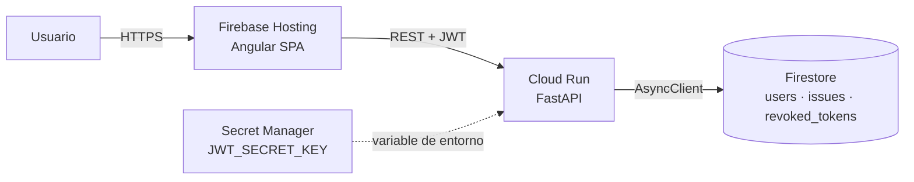

# Issue Tracker - Gestión de Incidencias

Aplicación web full stack para registrar, dar seguimiento y resumir incidencias.
**Angular 20** en el frontend, **FastAPI (Python 3.12)** en el backend, **Google Firestore**
como base de datos, desplegada en **Google Cloud Platform** (Cloud Run + Firebase Hosting).

| Componente | URL |
|---|---|
| Aplicación web (Firebase Hosting) | `https://issues.nextsof.com (alternativa https://issue-tracker-jc-2026.web.app)` |
| API (Cloud Run) | `https://issue-tracker-api-703349030986.us-central1.run.app` |
| Health | `La URL del API seguida de /health` |
| Documentación interactiva (solo en local) | `http://localhost:8000/docs` |

---

## Usuarios disponibles

El alta, baja y modificación de usuarios no forma parte del alcance. Se proveen cuentas predefinidas;
sus contraseñas se almacenan **únicamente como hash Argon2id**.

| Usuario | Contraseña | Nombre | Rol |
|---|---|---|---|
| `admin` | `Admin#2026` | Jefferson Caicedo | Administrador |
| `soporte` | `Soporte#2026` | Servicio Soporte | Soporte |
| `analista` | `Analista#2026` | Usuario Analista | Usuario |

> El usuario no distingue mayúsculas (`ADMIN` = `admin`). La contraseña sí.

### Roles y permisos

El control de acceso es **por permisos** (RBAC): cada rol otorga un conjunto de permisos y el
código solo consulta permisos, nunca roles. La regla se aplica **en el backend** (respuesta
`403 Forbidden`); la interfaz únicamente oculta lo que el API rechazaría de todos modos.

| Capacidad | Administrador | Soporte | Usuario |
|---|:---:|:---:|:---:|
| Ver, crear y filtrar incidencias; ver el resumen del listado | ✔ | ✔ | ✔ |
| Cambiar prioridad y pasar a "En progreso" | ✔ | ✔ | ✔ |
| Dar por resuelta (Completado) o reabrir una completada | ✔ | ✔ | - |
| Modificar una incidencia ya completada | ✔ | ✔ | - |
| Eliminar incidencias | ✔ | ✔ | - |
| Vista **Resumen** con gráficos y estadísticas | ✔ | ✔ | - |

## Funcionalidad

| Requisito | Implementación |
|---|---|
| Iniciar / cerrar sesión | Login con JWT; el logout **revoca el token en el servidor** (no basta con borrarlo del navegador). |
| Visualizar incidencias | Listado ordenado por fecha, con autor, descripción, prioridad y estado. |
| Crear incidencias | Formulario con título, descripción y prioridad (alta, media, baja), validado en cliente y servidor. |
| Actualizar estado y prioridad | Edición en línea desde el listado (abierto, en progreso, completado). |
| Filtrar | Por estado y/o prioridad, desde los selectores o pulsando un estado del resumen. |
| Resumen | Total de incidencias y, por estado, la cantidad seguida del porcentaje, visible para todos en el listado. |
| Resolver / eliminar *(adicional)* | Botones por fila para Soporte y Administrador; la eliminación pide confirmación. |
| Vista de resumen *(adicional)* | Gráfico de anillo por estado, diagrama de Pareto, carga por prioridad y tabla cruzada estado × prioridad. |

## Arquitectura



El backend sigue **Clean Architecture** por capas; las dependencias apuntan siempre hacia el dominio:

```
API (routers, DTOs, manejo de errores)
   └─► Servicios (casos de uso: AuthService, IssueService)
          └─► Repositorios (interfaces) ◄── Firestore / Memoria (implementaciones)
                 └─► Dominio (entidades y enums, sin frameworks)
```

| Patrón | Dónde | Para qué |
|---|---|---|
| Repository | `backend/app/repositories` | Aislar la persistencia; cambiar Firestore por SQL sin tocar la lógica. |
| Dependency Injection / Composition Root | `backend/app/container.py` | Un único lugar conoce las implementaciones concretas. |
| Application Factory | `backend/app/main.py` | Crear instancias aisladas de la app (pruebas, entornos). |
| DTO | `backend/app/schemas` | Contrato público del API separado del dominio. |
| Store (signals) | `frontend/.../issue.store.ts` | Estado de la funcionalidad en un único lugar, con alcance de ruta. |
| Gateway | `frontend/.../issue-api.service.ts` | Cliente HTTP sin estado. |
| Interceptor | `frontend/src/app/core/http` | Autenticación y manejo de errores transversales. |

## Estructura del repositorio

```
issue-tracker/
├── backend/          API REST FastAPI          → ver backend/README.md
├── frontend/         Aplicación Angular        → ver frontend/README.md
├── postman/          Colección y entornos de Postman
└── docs/
    └── UAT.md        Plan de pruebas de aceptación de usuario
```

## Inicio rápido (local)

Requisitos: Python 3.12+, Node.js 22 LTS+, npm 10+.

```bash
# 1) Backend - persistencia en memoria, sin necesidad de GCP
cd backend
python -m venv .venv && source .venv/bin/activate      # Windows: .venv\Scripts\activate
pip install -r requirements-dev.txt
cp .env.example .env                                   # y definir JWT_SECRET_KEY
uvicorn app.main:app --reload --port 8000

# 2) Frontend - en otra terminal
cd frontend
npm ci
npm start                                              # http://localhost:4200
```

## Calidad y pruebas

| Capa | Tipo | Comando | Resultado |
|---|---|---|---|
| Backend | Unitarias + integración API | `pytest --cov` | 101 pruebas, 99 % de cobertura (incluye Firestore con un doble del SDK) |
| Backend | Aceptación de usuario (UAT) | `pytest -m acceptance` | 8 historias de usuario |
| Backend | Lint y formato | `ruff check . && ruff format --check .` | Sin hallazgos |
| Frontend | Unitarias (Karma + Jasmine) | `npm run test:ci` | 87 pruebas, 96 % de cobertura |
| Frontend | Tipado estricto | `npm run typecheck` | Sin errores |
| API | Colección Postman | `npx newman run postman/IssueTracker.postman_collection.json -e postman/IssueTracker.local.postman_environment.json` | 31 peticiones, 60 aserciones (incluye los 403 por rol) |
| UI | UAT manual | `docs/UAT.md` | 42 casos con trazabilidad |

## Decisiones de Seguridad

- **Autorización por permisos** (RBAC) aplicada en la capa de servicios: aunque se llame al API sin pasar por la interfaz, un usuario sin permiso recibe `403`.
- Contraseñas con **Argon2id** (recomendación OWASP); comparación en tiempo constante para no revelar si un usuario existe.
- **JWT** firmado (HS256) con `exp`, `iat`, `nbf`, `iss` y `jti`; algoritmos permitidos explícitos (bloquea `alg=none`); revocación por `jti` en el logout.
- Secreto JWT fuera del código (Secret Manager en GCP, `.env` en local); el arranque falla si mide menos de 32 caracteres.
- Validación estricta de entradas (Pydantic, `extra="forbid"`); CORS limitado al dominio del frontend; cabeceras de seguridad (HSTS, `nosniff`, `X-Frame-Options`).
- Errores homogéneos que **no exponen trazas ni detalles internos**; los fallos se registran en logs JSON compatibles con Cloud Logging.
- Frontend: el token solo se envía a la URL del API (no a terceros), se guarda en `sessionStorage` y se descarta al expirar; protección contra *open redirect* en `returnUrl`.
- Contenedor con imagen *slim* multi-etapa y usuario sin privilegios; Swagger desactivado en producción.

## Decisiones técnicas

- **Firestore**: los filtros por igualdad no requieren índices compuestos. El orden por fecha se aplica en memoria para no exigir índices adicionales; con volúmenes grandes se agregaría paginación por cursor e índice compuesto `status + created_at`.
- **Resumen con agregaciones `COUNT`** de Firestore: no descarga documentos y su costo es mínimo.
- **Resumen global**: no cambia al filtrar, para que siempre refleje el panorama completo.
- **Estado y prioridad en inglés en el API** (`open`, `high`…) y en español en la interfaz: contrato estable e independiente del idioma.
- **Todos los usuarios ven todas las incidencias**, como piden los requerimiento; se registra el autor (`created_by`). Los roles solo restringen las acciones de cierre, eliminación y la vista de estadísticas.
- **El resumen del listado es visible para todos**: los requerimientos lo exigen para cualquier usuario. La vista detallada con gráficos es la que se reserva a Soporte y Administrador.
- **Un usuario normal no puede completar ni modificar una incidencia completada**: cerrar un ticket es responsabilidad de Soporte.
- **Eliminación física**: la incidencia se borra definitivamente de Firestore (su documento en la colección `issues`) y la acción queda registrada en los logs, indicando quién la eliminó y cuál fue. Si se requiriera auditoría completa, el siguiente paso sería un borrado lógico: marcar la incidencia con un campo `deleted_at` en lugar de eliminarla, para poder consultarla o restaurarla después.